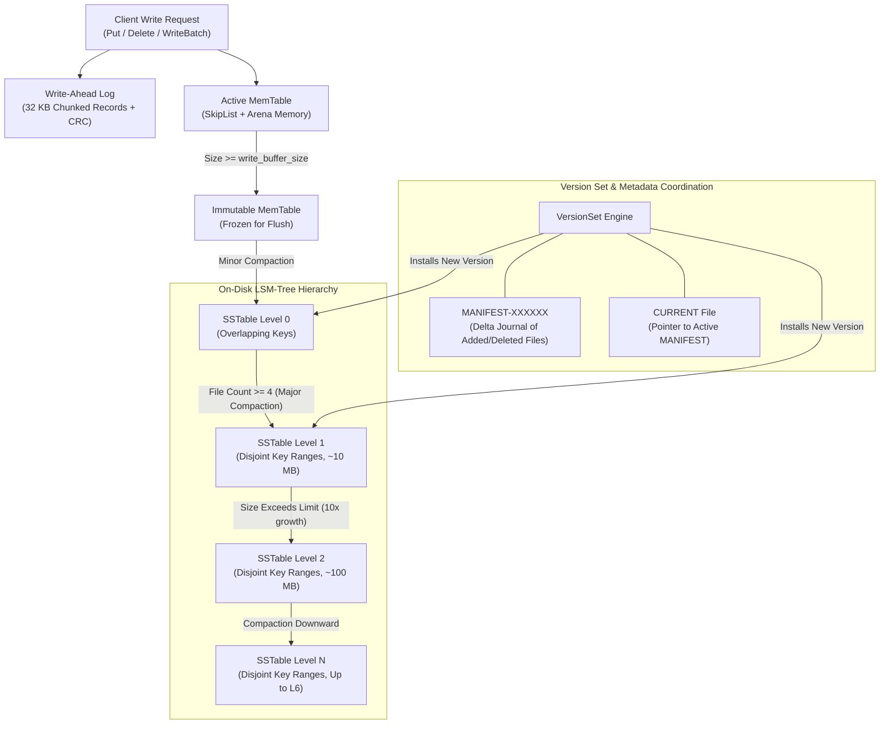
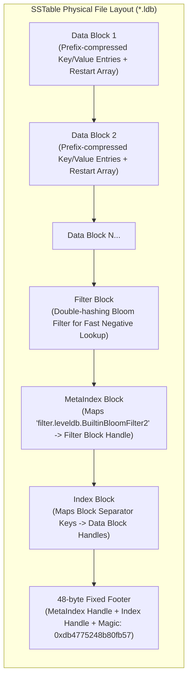
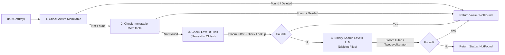

# LevelDB C++ Implementation

A complete, clean, end-to-end modern C++ (C++20) implementation of the Log-Structured Merge-tree (LSM-tree) storage engine.

---

> [!CAUTION]
> **DISCLAIMER: EDUCATIONAL & LEARNING PURPOSE ONLY**
> This repository is created solely for personal educational study and exploratory learning of LSM-tree internals, storage engine mechanics, and C++20 concurrency primitives. It is **not** intended for production environments.

---

## 🌟 Acknowledgement & Shoutout

> [!NOTE]
> **Massive shoutout to Google's [LevelDB](https://github.com/google/leveldb)** created by **Sanjay Ghemawat** and **Jeff Dean**.
> Their elegant LSM-tree architecture, write-ahead logging format, block prefix-compression designs, and two-level table indexing served as the direct inspiration and foundational blueprint for this project.

---

## 🏗️ Architecture & Component Overview

### End-to-End System Architecture



---

### SSTable Physical File Format



---

### Read Path Hierarchy



---

## 📝 Design Decisions & Engineering Observations

### 1. InternalKey Representation
* **Key Encoding**:
  $$\text{InternalKey} = [\text{User Key Bytes}] + [(\text{Sequence Number} \ll 8) \mid \text{ValueType}]$$
* **Ordering Logic**:
  1. `user_key` ascending (bytewise lexicographical).
  2. `sequence_number` **descending** (higher sequence numbers are newer, hence sorted first).
  3. `ValueType` descending (`kTypeValue = 1`, `kTypeDeletion = 0`).
* **Observation**: Seeking to $(K, \text{SnapshotSeq}, \text{kValueTypeForSeek})$ lands directly on the most recent visible update at or before the snapshot sequence number without needing backward scans.

### 2. SkipList vs. Balanced Trees
* **Observation**: SkipLists allow concurrent readers without mutex locking via release/acquire memory barriers (`std::memory_order_release` and `std::memory_order_acquire`).
* Combined with a dedicated memory `Arena`, individual node deallocations are eliminated; memory is reclaimed in a single sweep when the `MemTable` reference drops to zero.

### 3. Prefix Compression & Binary Search
* SSTable data blocks use delta prefix compression:
  `[shared_len][unshared_len][val_len][unshared_key_bytes][val_bytes]`.
* Every 16 entries (configurable restart interval), a full uncompressed key is stored and its offset recorded in a restart table. This permits $O(\log(\text{restarts}))$ binary search across blocks.

### 4. Bloom Filter Disk I/O Pruning
* SSTables write a Bloom filter bitset alongside data blocks using double hashing ($g_i(x) = (h_1 + i \cdot h_2) \pmod m$).
* At 10 bits per key, negative queries are filtered with $\approx 99\%$ accuracy, eliminating unnecessary random disk seeks.

### 5. Compactions & Tombstone Purging
* **Minor Compaction**: Directly dumps the frozen immutable `MemTable` into Level 0.
* **Major Compaction**: Detects score threshold exceedances (`L0 >= 4` files, or level size limits) and merges overlapping files down to $L_{i+1}$ using a `MergingIterator`.
* **Tombstone Safety Rule**: Deletions (`kTypeDeletion`) are only discarded during compaction when merged into the deepest level ($L_{\text{max}}$); dropping them earlier risks resurrecting older values from lower levels.

---

## 🛠️ Building & Testing

### Prerequisites
* GCC or Clang with C++20 support
* CMake 3.20+

```bash
mkdir -p build && cd build
cmake ..
cmake --build .
ctest --output-on-failure
```

---

## 💻 Code Example

```cpp
#include <iostream>
#include "leveldb/db.h"

int main() {
    leveldb::DB* db = nullptr;
    leveldb::Options options;
    options.create_if_missing = true;

    leveldb::Status s = leveldb::DB::Open(options, "/tmp/demo_db", &db);
    if (!s.ok()) {
        std::cerr << s.ToString() << std::endl;
        return 1;
    }

    // 1. Put
    db->Put(leveldb::WriteOptions(), "user:101", "Alice");

    // 2. Get
    std::string val;
    db->Get(leveldb::ReadOptions(), "user:101", &val);
    std::cout << "Read value: " << val << std::endl;

    // 3. Batch write
    leveldb::WriteBatch batch;
    batch.Put("user:102", "Bob");
    batch.Delete("user:101");
    db->Write(leveldb::WriteOptions(), &batch);

    // 4. Iterate
    leveldb::Iterator* it = db->NewIterator(leveldb::ReadOptions());
    for (it->SeekToFirst(); it->Valid(); it->Next()) {
        std::cout << it->key().ToString() << " => " << it->value().ToString() << std::endl;
    }
    delete it;

    delete db;
    return 0;
}
```
